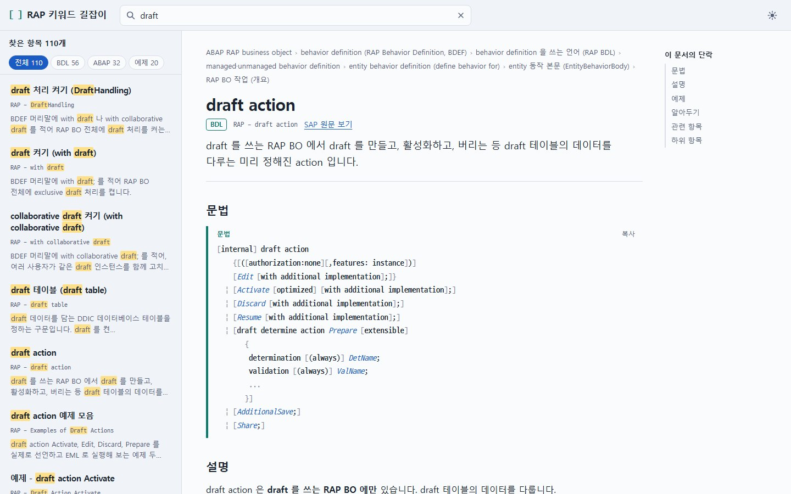

# RAP 키워드 길잡이

ABAP RAP(RESTful Application Programming Model)의 키워드를 **쉬운 한글**로 풀어 쓴 참고서입니다.
SAP ABAP 키워드 문서(ABAP Cloud)의 "ABAP RAP Business Objects" 갈래 384개 항목을 같은 목차 구조로 담았습니다.

`managed`, `draft`, `action`, behavior definition 같은 RAP 용어는 현장에서 부르는 대로 **원문 그대로** 씁니다.
덜 익숙한 말은 항목마다 처음 나올 때 `behavior pool(동작 풀)` 처럼 괄호에 한글을 달았습니다. 검색은 한글 표기로도 됩니다.

- 왼쪽: 원문과 같은 순서의 목차 (접고 펼 수 있음)
- 오른쪽: 항목마다 문법 틀, 설명, 예제 코드, 알아둘 점
- 위쪽: 키워드 검색 (영문·한글 모두, 갈래별로 좁혀 보기)



## 쓰는 법

설치할 것이 없습니다. **`index.html` 파일 하나**가 앱 전체입니다.

1. 이 저장소를 내려받습니다. 화면 위쪽의 `Code` → `Download ZIP` 을 누르거나, 아래 명령을 복사해 실행합니다.

   ```
   git clone https://github.com/TaehwanShin/abap-rap-keyword-guide-ko.git
   ```

2. 내려받은 폴더의 `index.html` 을 두 번 눌러 브라우저로 엽니다.

인터넷이 없어도 돌아갑니다. 실행할 때 바깥에서 불러오는 것이 하나도 없습니다.
GitHub Pages 를 켜면(Settings → Pages → Branch 를 고르고 폴더는 `/ (root)`) 웹 주소로도 볼 수 있습니다.

### 화면 다루기

| 하려는 일 | 방법 |
| --- | --- |
| 검색창으로 가기 | `/` 또는 `Ctrl + K` |
| 검색 결과 고르기 | `↑` `↓` 로 옮기고 `Enter` |
| 검색을 끝내고 목차에서 지금 항목의 자리 보기 | 검색 결과 위의 `목차에서 보기`, 또는 `Esc` (문서를 읽는 중에도 됨), 또는 검색창 오른쪽 `×` |
| 검색 결과 좁히기 | 결과 위의 `BDL` · `ABAP` · `예제` 단추 |
| 코드 가져가기 | 코드 상자 오른쪽 위 `복사` |
| 밝은 화면 / 어두운 화면 | 오른쪽 위 해·달 단추 |
| 목차 너비 바꾸기 | 목차와 문서 사이 경계선을 끌기 (키보드는 경계선에 초점을 두고 `←` `→`) |
| 특정 항목 주소 공유 | 주소창의 `#/항목id` 를 그대로 복사 |
| 연결된 항목 미리 보기 | 본문의 연결에 마우스를 올리거나 `Tab` 으로 초점을 두면 그 항목의 제목·요약·단락이 뜸 (`Esc` 로 닫기) |
| 읽던 자리로 돌아가기 | 연결을 따라갔다가 브라우저의 뒤로 가기를 누르면 읽던 자리로 돌아옴 |
| 문서 안에서 옮겨 다니기 | 오른쪽 "이 문서의 단락"(좁은 화면은 요약 아래의 접힌 목록)에서 고르기. 지금 읽는 단락이 굵게 보임. 내려가면 오른쪽 아래에 `맨 위로` 단추 |
| 찾은 낱말 사이 오가기 | 검색 결과에서 항목을 열면 본문 위에 `찾은 낱말 N곳` 막대가 뜸. `이전` `다음` 으로 옮기고 `표시 지우기` 로 끔 |
| 최근 본 항목 | 검색창에 초점을 두면(검색어가 없을 때) 최근 본 항목 열 개가 목차 자리에 보임 |
| 위 항목·앞뒤 항목으로 가기 | 문서 끝의 `앞 항목` · `위 항목` · `다음 항목` |

여러 낱말을 띄어 쓰면 **모두 들어 있는** 항목만 찾습니다. 예) `draft action`, `lock master`

## 무엇이 들어 있나

| 갈래 | 내용 |
| --- | --- |
| RAP 비즈니스 서비스 | 서비스 정의와 서비스 바인딩이 하는 일 |
| behavior definition (BDL) | `managed` / `unmanaged`, entity 동작, action·function·determination·validation, draft, 잠금, 권한, projection, interface, extension |
| RAP BO 를 제공하는 ABAP | behavior pool, handler method(`FOR MODIFY`, `FOR READ` …), saver method |
| RAP BO 를 쓰는 ABAP (EML) | `MODIFY ENTITIES`, `READ ENTITIES`, `COMMIT ENTITIES`, `GET PERMISSIONS`, `SET LOCKS` … |
| BDEF derived type | `TYPE TABLE FOR`, `TYPE STRUCTURE FOR`, `%tky` · `%cid` · `%control` 같은 구성요소 |
| business event | `RAISE ENTITY EVENT`, event handler class |
| 예제 | 원문 예제 프로그램의 핵심을 짧게 다시 쓴 코드와 풀이 |
| 용어집 | RAP 용어를 영문 철자순으로 정리 |

예제 코드는 모두 여행(`ZR_Travel`)과 예약(`ZR_Booking`)이라는 같은 모델을 씁니다.
예제는 그 항목의 문법만 보이게 줄인 코드입니다. 필드 매핑(`mapping for`)이나 키 필드 특성처럼 주제와 상관없는 부분은 빠져 있고, 줄이지 않은 모델은 첫 화면 항목의 "이 참고서의 예제 읽는 법"에 있습니다.

## 고쳐 쓰기

본문은 `content/topics/<항목id>.md` 에 항목마다 파일 하나로 들어 있습니다. 고친 뒤 다시 만듭니다.

```
npm install      # 처음 한 번
npm run check    # 형식 검사
npm run build    # index.html 다시 만들기
```

빌드에는 Node.js 18 이상이 필요합니다. 만들어진 `index.html` 은 외부 라이브러리 없이 혼자 돌아갑니다.

파일 형식, 말투, 용어 표기, 예제 모델은 [`AGENTS.md`](AGENTS.md) 에 정리해 두었습니다.
사람이 고칠 때도, Codex 나 Claude Code 같은 코딩 도우미에게 맡길 때도 같은 문서를 기준으로 삼습니다.

```
content/toc.json        목차 (SAP 원문과 같은 구조)
content/topics/*.md     항목 본문
src/                    화면 (HTML 틀, CSS, JS)
tools/build.mjs         index.html 만들기
tools/check.mjs         형식 검사
index.html              결과물
```

## 알아둘 점

- **비공식 자료입니다.** SAP 가 만들거나 검수한 문서가 아닙니다.
- 원문을 그대로 옮긴 번역이 아닙니다. 원문을 읽고 한글로 새로 풀어 썼으며, 문법 틀만 원문 표기를 따릅니다. 예제 코드도 새로 썼습니다.
- 예제 코드는 SAP 시스템에서 활성화해 확인한 것이 아닙니다.
- 줄여 쓰는 과정에서 빠지거나 틀린 곳이 있을 수 있습니다. 중요한 판단은 항목마다 달린 **"SAP 원문 보기"** 로 원문을 확인하고 하세요.
- 기준 원문: [ABAP Keyword Documentation (ABAP Cloud) - ABAP RAP Business Objects](https://help.sap.com/docs/abap-cloud/abap-keyword/abap-rap-business-objects?locale=en-US)
- 틀린 곳을 찾으면 Issue 나 Pull Request 로 알려 주세요.

## 라이선스

이 저장소의 코드(`src/`, `tools/`)는 [MIT 라이선스](LICENSE)를 따릅니다.
SAP, ABAP 은 SAP SE 의 상표이며, 원문 문서의 권리는 SAP 에 있습니다.
